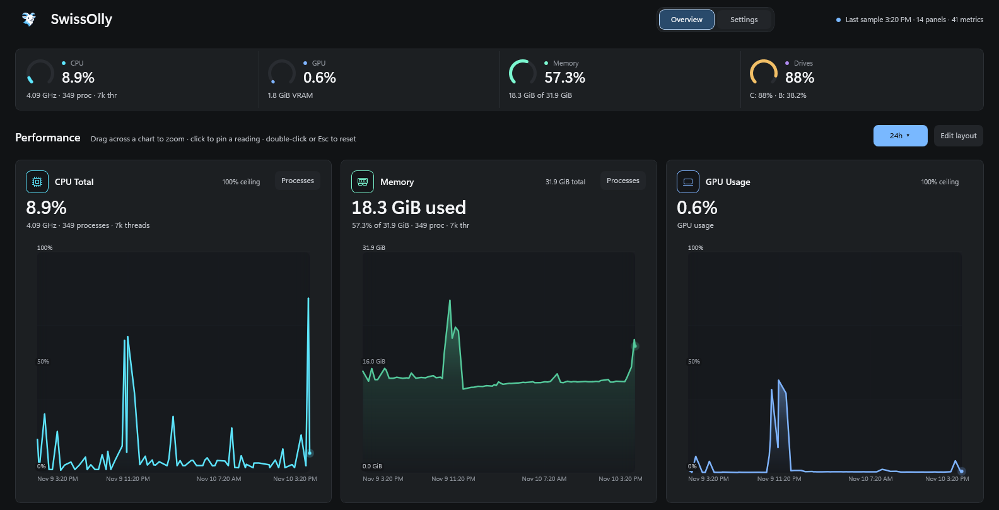
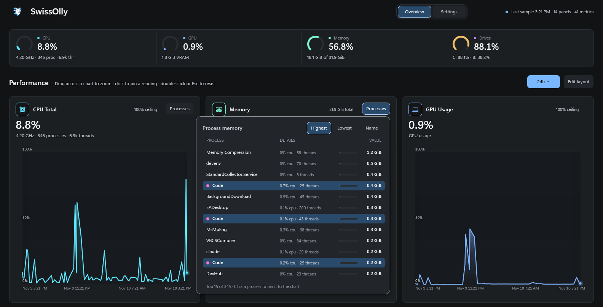
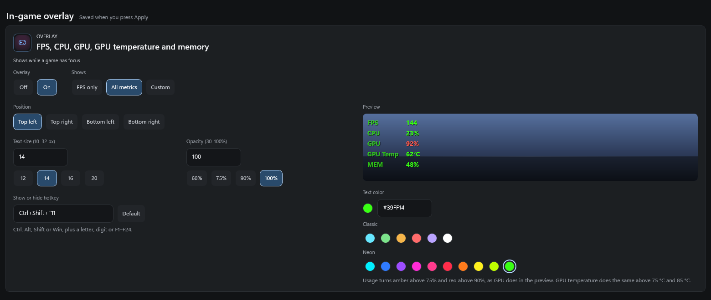
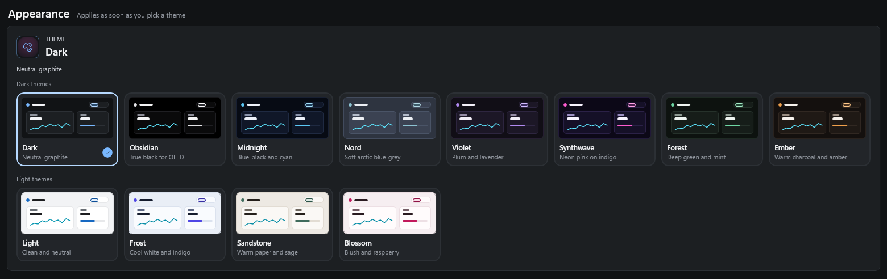

# SwissOlly

Local Windows system monitor. Live and historical telemetry, stored on-disk in SQLite, rendered in WinUI 3.



## Overview

SwissOlly samples hardware counters on a configurable interval, persists them to a local SQLite database, and renders time-series charts and per-process breakdowns. No network calls, no cloud sync, no account.

## What it shows



Summary gauges for CPU, GPU, memory, and drives with threshold coloring at 75% and 90%.

Panels for:

| Metric | Tracked |
|--------|---------|
| CPU | Total usage, per-core, current clock (including boost) |
| GPU | Utilization (busiest engine, as Task Manager shows it), VRAM, temperature |
| Memory | Used / available / total |
| Disk | Read/write throughput per drive, capacity |
| Network | Down/up per interface |
| Processes | Per-process CPU and memory, services included; the top 15 (50 as you scroll), sortable, pin any to the chart |
| Host activity | Process, thread and handle counts |

CPU figures follow Task Manager: total CPU is `% Processor Utility`, and a process's CPU is its share of the whole machine. Process memory is the private working set, the measure in Task Manager's Memory column.

Chart interactions:

- Pick a range (1m, 5m, 15m, 30m, 1h, 12h, 24h, 2d, 5d, 7d, 30d, 90d, 1y) or type a custom From/To; Ctrl+[ and Ctrl+] step through the presets
- Drag across a chart to zoom; double-click or Esc to return to the live window
- Click a chart to pin a reading
- Click a legend entry (or press Enter on it) to show only that series
- Gaps in the history, such as while the PC was off, stay gaps instead of being joined by a line

Layout:

- **Edit layout** (Ctrl+E): drag panels to move them, drag any edge or corner to resize them on a 12-column grid. Cancel puts everything back; Done saves it.
- From the keyboard: Tab to a panel, arrows move it, Shift+arrows resize it.

## Overlay

An in-game telemetry overlay that paints on top of running games. Owned by the main SwissOlly process — no second window, no taskbar entry, no Alt+Tab entry. Configure it in Settings.



- Three modes: FPS only, all metrics (FPS + CPU + GPU + GPU temp + memory), or Custom (pick your own)
- Corner positioning (top-left, top-right, bottom-left, bottom-right)
- Text color from six classic and ten neon presets, or any hex value; font size, opacity, and toggle hotkey, with a live preview in Settings
- Outlined text with no background box, for a clean HUD look over any game
- Auto-shows when a game has focus; hides on Alt+Tab back to desktop
- FPS counts the game's own DXGI/D3D9 present calls via ETW (not monitor refresh, and not a count of frames confirmed displayed) — if ETW access is unavailable, SwissOlly shows no FPS instead of a misleading refresh-rate estimate
- NVIDIA, AMD, and Intel GPU support

Targets borderless and windowed-fullscreen games. True exclusive fullscreen isn't supported — by design, so SwissOlly never needs code-signing or elevated UIAccess to draw the overlay.

Reading the per-process present rate requires membership in the built-in **Performance Log Users** group. The installer offers to add you (the "Allow exact FPS" option, on by default) so SwissOlly itself runs as a normal user process, and uninstalling removes that membership again. Windows only applies group changes to a new logon token, so **sign out and back in once after installing**. Until then the FPS field shows `--` rather than the monitor refresh rate.

## Settings

- **Collection:** scrape interval, 1–60 seconds
- **Retention:** 1 minute to 10 years (30m, 24h, 7d…). Lowering it asks before deleting older history.
- **Storage:** any folder on a local drive. A different folder starts its own history; nothing is moved.
- **Window:** start with Windows (in the notification area), and whether closing the window keeps SwissOlly running in the tray or exits
- **Theme** and the **overlay**

A theme and the window options apply as soon as you pick them; everything else waits for **Apply**, which floats at the bottom of Settings whenever something is unapplied (Ctrl+S works too).

Only one copy runs at a time; opening SwissOlly again brings the running window forward.

### Themes

Twelve palettes, each shown in Settings as a small preview of the app in that theme:



| Theme | Tone |
|-------|------|
| Dark | Neutral graphite (default) |
| Obsidian | True black for OLED screens, monochrome chrome |
| Midnight | Deep blue-black, cyan accent |
| Nord | Soft arctic blue-grey |
| Violet | Muted plum, lavender accent |
| Synthwave | Deep indigo, neon pink accent |
| Forest | Deep green-grey, mint accent |
| Ember | Warm charcoal, amber accent |
| Light | Clean white |
| Frost | Cool blue-white, indigo accent |
| Sandstone | Warm paper, sage accent |
| Blossom | Blush, raspberry accent |

Every palette keeps the same structural relationships — hairline strokes, one-step card elevation, text at least 4.5:1 against every surface (WCAG AA) — so a theme is a recolour, never a relayout. Threshold colours stay amber/red in all of them, because those encode meaning rather than style, and chart lines keep their hues from theme to theme, darkened on the light themes so they stay at least 3:1 against the plot.

SwissOlly always draws with its own palettes; it does not follow Windows contrast themes.

## Install

Installers at [Releases](https://github.com/swissolly/SwissOlly/releases), with SHA-256 checksums in `SHA256SUMS.txt`:

- `SwissOllySetup-<version>-x64.exe` — Intel/AMD 64-bit
- `SwissOllySetup-<version>-ARM64.exe` — ARM64

The installers are self-contained: .NET and the Windows App SDK runtime are included, so nothing else needs installing.

### Build from source

```powershell
git clone https://github.com/swissolly/SwissOlly.git
cd SwissOlly
dotnet restore SwissOlly.sln
dotnet run --project SwissOlly.App/SwissOlly.App.csproj -p:Platform=x64
```

Or open `SwissOlly.sln` in Visual Studio, set `SwissOlly.App` as startup, choose Debug / x64, press F5. Debug builds use the installed Windows App Runtime 1.8.

## Requirements

- Windows 10 1809+ (build 17763)
- x64 or ARM64

## Architecture

```
SwissOlly.Core        Models, enums, interfaces, layout engine, chart helpers
SwissOlly.Collector   PDH counters, system process snapshot, LibreHardwareMonitor
SwissOlly.Store       SQLite (WAL) + JSON config
SwissOlly.Overlay     In-game overlay, ETW frame counting
SwissOlly.App         WinUI 3 shell
```

Background collector samples hardware counters every 2 seconds (configurable). Snapshots are written to SQLite with automatic retention pruning: raw samples for the last 6 hours, one-minute averages before that. If history can't be written (disk full, storage drive unplugged), the live board keeps updating and saving resumes on its own. The UI updates via DispatcherQueue. Chart rendering uses deterministic min/max bucket downsampling.

## Defaults

| Setting | Default |
|---------|---------|
| Scrape interval | 2 seconds |
| Graph window | 15 minutes |
| Retention | 24 hours |
| Storage | `%LocalAppData%\SwissOlly\Data` |
| Theme | Dark (12 available) |
| Closing the window | Keeps running in the tray |

## Privacy

No network calls, no telemetry, no update pings. SwissOlly writes only to its settings folder (`%LocalAppData%\SwissOlly`) and the storage folder. The history database holds metric values and the names of the panels they belong to (such as drive and network adapter names), nothing else; process lists are shown live and never saved. A custom storage folder keeps the permissions of the folder it is created in, so on a shared PC pick one under your own user profile. The settings folder also holds two local logs: `startup-trace.log` (the last launch) and `crash.log` (errors that closed the app). Uninstalling keeps settings and history; delete `%LocalAppData%\SwissOlly` to remove them.

## Roadmap

See [ROADMAP.md](ROADMAP.md).

## Support

SwissOlly is free and stays free. If it's useful to you, you can [sponsor it on GitHub](https://github.com/sponsors/swissolly).

## License

GNU AGPL-3.0. See [LICENSE](LICENSE). The libraries SwissOlly ships, and their licenses, are
listed in [THIRD-PARTY-NOTICES.txt](THIRD-PARTY-NOTICES.txt); the installer puts both files
beside the app.
